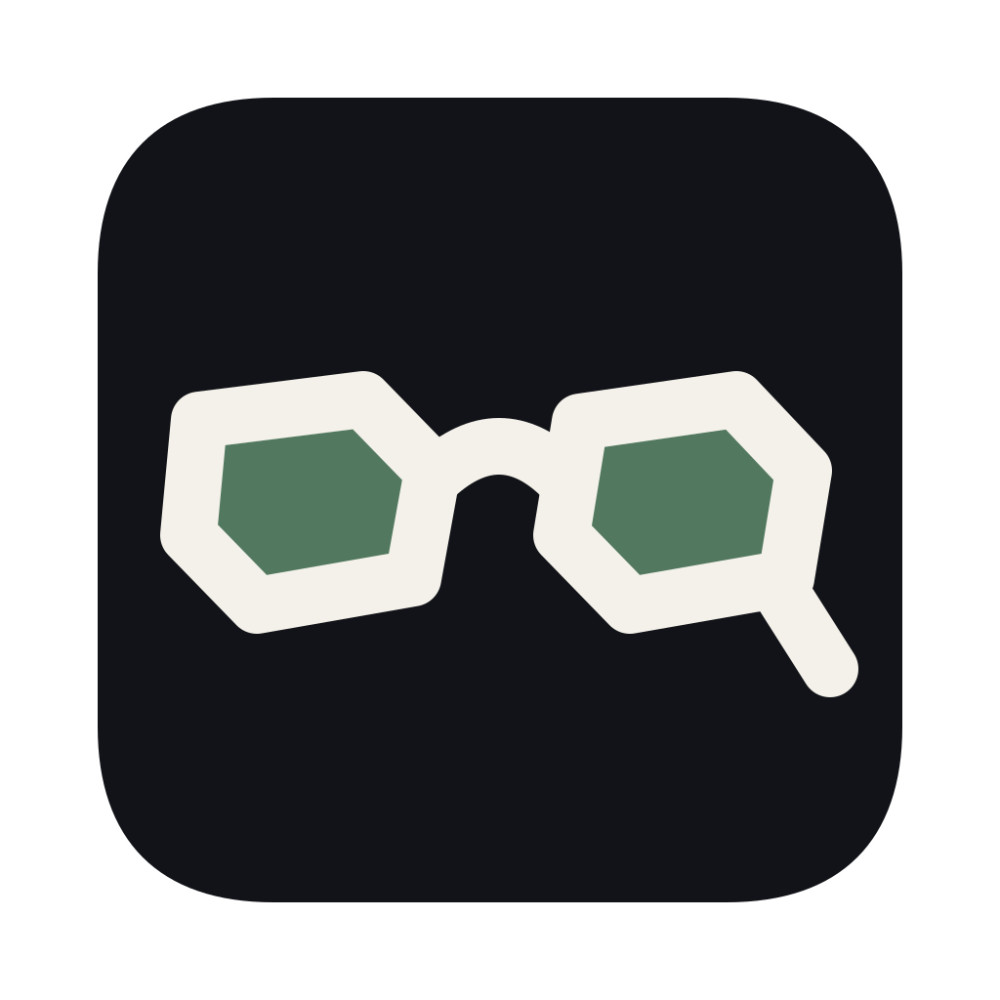
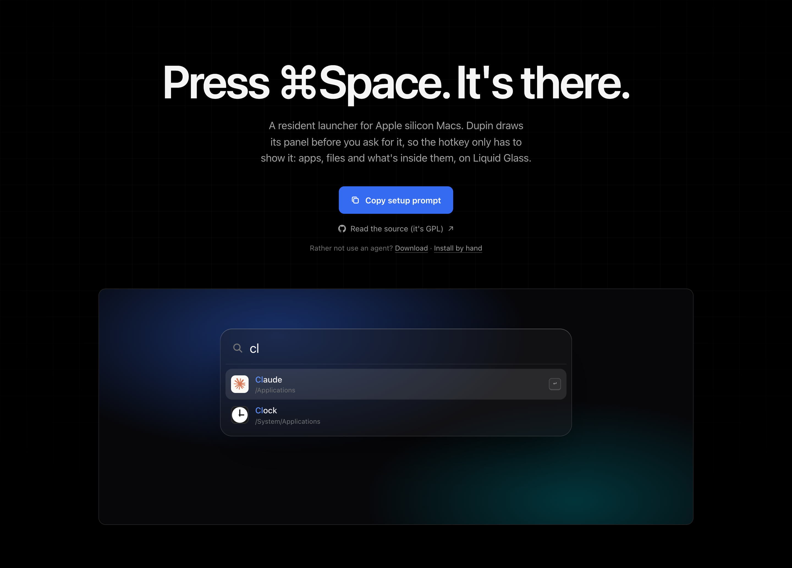

<div align="center">
    
    <h1>Dupin</h1>
</div>

<p align="center">
    <a href="https://dupin.app">dupin.app</a>
</p>

<div align="center">
    <a href="https://dupin.app"></a>
</div>

> A lightweight, resident launcher for Apple silicon Macs.

- Fuzzy-search and open apps, by any name macOS knows them by
- Space on an empty query searches files with Spotlight; `in` and Space search inside them; `define` and Space looks up a word in macOS dictionaries
- A hotkey (⌘Space by default) shows the panel at once, on Liquid Glass
- An optional shader animates behind the panel and reacts to typing; bring your own WGSL, as with Ghostty's custom shaders ([examples](./examples/shaders))

## Quick start

Free ⌘Space first: turn off Spotlight's shortcut and unassign it in any other launcher ([how](./docs/configuration.md#freeing-the-hotkey)). Then install it with Homebrew (`dupin@nightly` for builds of `main`); it [updates itself](./docs/configuration.md#updates):

```sh
brew install --cask x-ryoppippi/tap/dupin
```

Or build it with Nix:

```sh
nix build .#dupin
open result/Applications/Dupin.app
```

## Documentation

See [docs/](./docs/README.md) for using, configuring and developing Dupin.

## Major Sponsors

<p align="center">
    <a href="https://coderabbit.link/ryoppippi">
        <picture>
            <source media="(prefers-color-scheme: dark)" srcset="./docs/public/coderabbit-logo-dark.svg">
            
        </picture>
    </a>
    &nbsp;&nbsp;&nbsp;&nbsp;
    <a href="https://blacksmith.sh">
        <picture>
            <source media="(prefers-color-scheme: dark)" srcset="./docs/public/blacksmith-logo-dark.svg">
            
        </picture>
    </a>
</p>

## GitHub Sponsors

<p align="center">
    <a href="https://github.com/sponsors/ryoppippi">
        
    </a>
</p>

## System commands

Type `sleep` or `lock` in the ordinary launcher, select Sleep or Lock Screen,
and explicitly activate the result with Enter. Typing and completing a query do
not execute commands. Sleep requests full machine sleep via `pmset sleepnow`.
Lock Screen posts the standard Control–Command–Q shortcut using public CoreGraphics
APIs, only if event-synthesis access is already available. Dupin does not request
permissions or change shortcuts or password policy. Refusals appear in the launcher.

Manual validation remains required: full sleep and wake, the standard lock shortcut
on the user's keyboard layout and shortcut configuration, and permission-refusal
notices in the packaged app. CoreGraphics acknowledges posting, not successful
locking; a changed or intercepted shortcut may prevent locking. Unattended tests
use injected runners and never invoke these operations. Restart, shut down, log
out, empty Trash, eject disks, dark mode and app termination remain outside this
first slice of issue #25.

## License

Dupin is licensed under [GPL-3.0-or-later](./LICENSE). Contributions need the [Contributor License Agreement](./CLA.md); see [CONTRIBUTING.md](./CONTRIBUTING.md).
